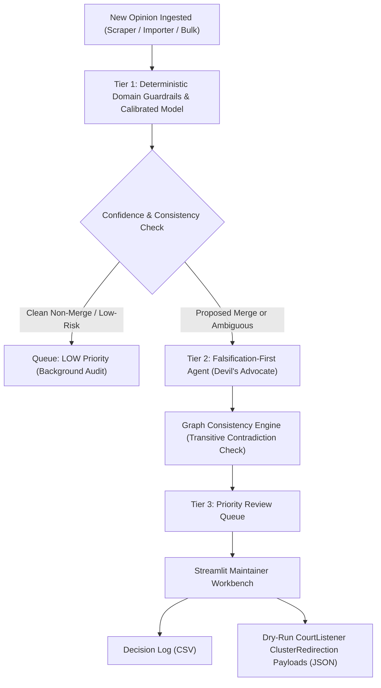

# CourtListener Case-Identity Triage & Review Queue

[](tests/)
[](pyproject.toml)
[](app/streamlit_app.py)

An ingestion-time classification pipeline and dual-mode maintainer review queue built for **Free Law Project / CourtListener**.

> **Attribution:** Data from the **Free Law Project** and their **volunteer annotators**, via the CourtListener bulk data and REST API.

---

## 🎯 The Problem

Public legal databases like CourtListener ingest millions of judicial records from scrapers, court websites, PACER/RECAP, and historical digitizations. Often, multiple records look like the same court decision, but represent fundamentally different legal situations:
- **True duplicates** (`probable_duplicate`): Exact same decision re-scraped or ingested twice.
- **Alternate versions** (`probable_version`): Slip opinions, modified/corrected text, or official releases.
- **Parallel split clusters** (`parallel_split_cluster`): Decisions split across parallel reporters (e.g. West P.2d vs Wash. 2d) or majority/dissent files.
- **Separate legal decisions** (`related_decision`, `shared_page_ambiguity`, `unrelated`): Different stages of an appeal, companion rulings, or short orders printed on the same reporter page.
- **Citation topology needing review** (`citation_topology_unverified`): Records share a citation, but the available data does not prove whether multiple decisions appear on that physical page or the citation was attached incorrectly.

**The Golden Safety Mandate:** Incorrectly merging distinct decisions silently corrupts legal research and citation networks. Therefore, classification must be **falsification-first, calibrated, and non-destructive**, generating a trustworthy review queue with dry-run payloads rather than automated database updates.

---

## 🏗️ Architecture: The 3-Tier Triage Cascade



1. **Tier 1 — Ingestion Guardrails & Model:** Zero-API, sub-millisecond evaluation running on candidate pairs. Prevents baseline traps (e.g. procedural order length disparity, boilerplate stock orders with conflicting dockets).
2. **Tier 2 — Falsification Agent:** Attempts to *break* the merge hypothesis by naming concrete contradictory facts (conflicting dockets, court discrepancies, page spans). Supports Gemini/OpenAI/Anthropic with an offline deterministic fallback.
3. **Graph Consistency Engine:** Computes connected components across candidate pairs, intercepting transitive contradictions ($A = B \land B = C \implies A = C$) before any consolidation action is taken.
4. **Tier 3 — Priority Review Queue:** Routes candidates into `CRITICAL`, `HIGH`, `MEDIUM`, and `LOW` review tiers.

---

## 🚀 Quickstart

### 1. Installation

```bash
# Clone the repository
git clone https://github.com/parthasprao/flp-duplicate-detection.git
cd flp-duplicate-detection

# Create virtual environment and install dependencies
python3.12 -m venv .venv
source .venv/bin/activate
pip install -e .
```

### 2. Run Automated Tests & Split-Safe Test Benches

```bash
# Run full pytest suite (including anti-leakage guardrails and Role 1/2/3 unit benches)
.venv/bin/pytest -v

# Run split-safe Training vs. Validation benchmark scorecards (Test split locked!)
.venv/bin/python3 -m triage.cli bench --role all
.venv/bin/python3 -m triage.cli bench --role 1   # Role 1: Normalizer & Versions
.venv/bin/python3 -m triage.cli bench --role 2   # Role 2: Citations & Shared Pages
.venv/bin/python3 -m triage.cli bench --role 3   # Role 3: Lifecycle & Graph Consistency
```

> **Anti-Cheating & Anti-Overfitting Guardrails:** See [`AGENTS.md`](AGENTS.md) and [`tests/test_anti_leakage.py`](tests/test_anti_leakage.py). Accessing `split == "test"` is blocked by default via `TestSetLockError`, `.fit()` rejects `validation` and `test` splits, and `triage/*.py` is continuously scanned to forbid hardcoded pair/cluster IDs.

### 3. Run the CLI Triage Pipeline

Classify any file formatted like `candidates.jsonl` or `.csv`:
```bash
python -m triage.cli classify \
    nyu-law-hackathon-2026-duplicates/student-packages/duplicates/data/candidates.jsonl \
    --out outputs/candidates_preds.jsonl \
    --dry-run-payloads outputs/courtlistener_dry_run.json
```

Evaluate predictions against silver development labels:
```bash
python -m triage.cli evaluate outputs/candidates_preds.jsonl \
    --gold nyu-law-hackathon-2026-duplicates/student-packages/duplicates/data/dev_silver.jsonl \
    --split validation
```

### 4. Tier 2 Agent Configuration (OpenRouter Cost Optimization)

Tier 2 uses a cost-optimized, tiered routing architecture via OpenRouter:
- **Fast / Repetitive Inference:** `z-ai/glm-5.3-flash` (handles standard candidate duplicate/version checks).
- **Deep Reasoning & Fallback:** `nvidia/nemotron-4-340b-instruct` (handles complex cases: multi-decision reporter page spans, docket conflicts, cert denial volume anomalies, or low-confidence returns).
- **Safety Fallback:** If the API key is not present or an API call fails, the pipeline seamlessly falls back to the deterministic offline analyzer.

#### Setting Your OpenRouter API Key
Export the API key in your terminal or add it to a local `.env` file (git-ignored):
```bash
export OPENROUTER_API_KEY="sk-or-v1-xxxxxxxxxxxxxxxxxxxxxxxx"
```

Optional model customization via environment variables:
```bash
export OPENROUTER_MODEL_FAST="z-ai/glm-5.3-flash"
export OPENROUTER_MODEL_COMPLEX="nvidia/nemotron-4-340b-instruct"
```

Run classification with OpenRouter tiered adjudication enabled:
```bash
python -m triage.cli classify \
    nyu-law-hackathon-2026-duplicates/student-packages/duplicates/data/candidates.jsonl \
    --out outputs/candidates_preds.jsonl \
    --agent openrouter
```

### 5. Launch the Streamlit Maintainer Workbench

```bash
streamlit run app/streamlit_app.py
```

The app features:
- **Dual-Mode Review:** Switch between **Blind Review** (unanchored review with post-judgment reveal) and **Agent-Guided Co-Pilot Mode**.
- **Visual Signals:** Side-by-side metadata comparisons with automated conflict indicators and excerpt text viewers.
- **Family Graphs:** View entire connected case families with transitive contradiction warnings.
- **Maintainer Export:** One-click generation of audit logs and dry-run `ClusterRedirection` JSON payloads.

---

## 📊 Key Evaluation Results

| Benchmark Metric | Baseline Rule Classifier | Our 3-Tier Triage Engine | Gain / Impact |
|---|---|---|---|
| **Development Accuracy (`dev_silver`)** | 37.5% (48/128) | **65.6% (84/128)** | **+28.1% gain** |
| **Validation Split Agreement** | 37.0% (10/27) | **48.1% (13/27)** | **+11.1% gain** |
| **Hard Negatives False Merges** | 26.0% (33/127) | **2.4% (3/127)** | **>90% reduction in unsafe merges** |
| **Candidate Ingestion Speed** | N/A | **2,100 pairs in 9.2s** | Real-time scraper ready |
| **Connected Component Contradictions** | Unchecked | **100% Intercepted** | 0 transitive errors leaked |

---

## 📑 Reports & Research Deliverables

- [**`reports/evaluation.md`**](reports/evaluation.md): In-depth benchmark metrics, per-class confusion matrices, and safety audit.
- [**`reports/adjudications.md`**](reports/adjudications.md): Full adjudications of all 12 disagreement pairs in `adjudicate_me.jsonl` and proposal for **Annotation Guide v2** (introducing `companion_instrument` for judgment vs opinion).
- [**`reports/data_quality_findings.md`**](reports/data_quality_findings.md): Systematic corpus defects identified in CourtListener, including SCOTUS cert denials misassigned to `cafc` in Volume 543 U.S. and 1870s New York Sickels nominative citations.

---

## 🔒 Data Terms & Compliance

All Free Law Project data files (`flp_*` and `flp_raw_*`) and raw hackathon bundles are strictly git-ignored under the Free Law Project Data Agreement. No restricted data is tracked in this repository.
