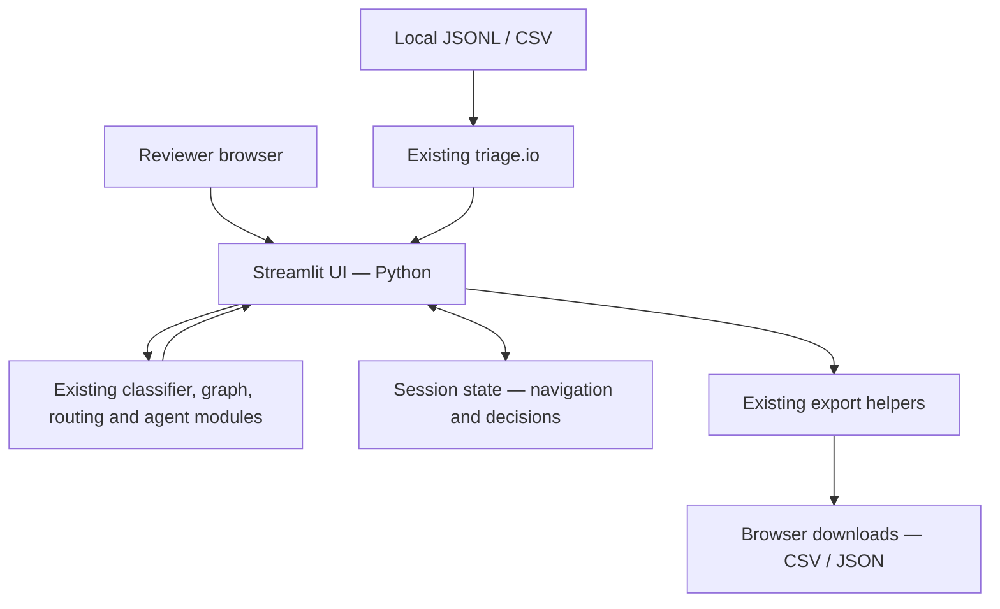

# Carla Bravo — Streamlit UI workbench

Branch: `carla-bravo/ui-workbench`

## Task and scope

Implement the repository's review UI using its existing Python + Streamlit stack.
Reuse `triage/` for analysis and exports; do not change classification rules,
model training, taxonomy, or database behavior. No React app, API server, database,
new runtime dependency, or production deployment is introduced.



## Run

From the repository root, with the existing dependencies installed:

```bash
streamlit run app/streamlit_app.py
```

Without local candidate data, the app opens the repository's synthetic demo.
The demo never links its made-up IDs to live records and uses only offline agent
analysis. To use permitted local data, set `TRIAGE_DATA_DIR` to its directory.
Held-out test rows are excluded; training uses only the training split.

For live data, the agent follows the existing provider configuration. It runs
only when the reviewer explicitly presses its button; the UI warns that an
online provider can receive metadata/excerpts. This branch does not change
provider behavior or configure credentials.

## Included

- Sidebar dataset selector, priority/label/status filters, reviewer name and progress.
- Previous/next navigation plus direct pair selection.
- Guided and blind modes; blind mode hides recommendations, priority, agent/family
  outputs and ignores prediction-based filtering/ordering until explicit reveal.
- Readable relationship labels, evidence and contradiction panels.
- Side-by-side metadata, safe CourtListener links, structural signals, excerpts
  and a plain-text excerpt diff.
- Agent results retained per pair during the session and labeled with tier/model.
- Connected-family table using the current reconciled predictions.
- Four review actions, keep-separate category selection, notes/evidence and
  proposed survivor selection.
- Separate first-decision snapshot retained in memory.
- Browser-downloadable CSV logs and dry-run JSON proposals, plus JSON preview/count.
  Downloads contain recorded decisions only, not unreviewed predictions.
- Temporary, isolated export files rather than shared server output paths.
- Explicit warnings that decisions are session-only and no database changes occur.

## Intentional limits

- No durable storage, authentication, interactive network graph or automatic merges.
- A decision is not a legal correctness guarantee or production execution approval.
- The initial-decision snapshot is in memory, not an immutable audit system; CSV
  and JSON downloads contain the latest decision for each pair.
- Explicit reveal is allowed in blind mode; it is not a strict blinded experiment.
- The existing exporter only emits redirect proposals for compatible numeric pair
  IDs; the displayed proposal count comes from the actual generated JSON.
- Synthetic fixtures are not an evaluation of the real corpus.

## Verification

```bash
.venv/bin/python3 -m pytest -q
.venv/bin/python3 -m triage.cli bench --role all
```

`tests/test_streamlit_app.py` uses Streamlit's built-in AppTest with synthetic
fixtures to exercise UI state and exports. No external model calls are required.
The benchmark needs the restricted local development datasets; if absent, report
that limitation rather than claiming corpus validation. Never unlock the test set.

### Results for this branch

- Baseline suite before UI edits: 44 passed, 5 skipped.
- Suite after the browser walkthrough fixes: 56 passed, 5 skipped, including
  12 UI/export tests.
- `git diff --check`: passed.
- Whole-project benchmark attempted but blocked by missing `dev_silver.jsonl`.
  The five skipped tests also require local development data.
- No held-out test split was unlocked; no external model calls were used.
- A local Chromium/Playwright walkthrough also exercised the synthetic demo,
  real browser downloads, blind-mode reveal and responsive layouts. See
  [the walkthrough report](ui-walkthrough.md) for coverage and limits.
- Verification environment: Python 3.13.11 and Streamlit 1.67.0.
